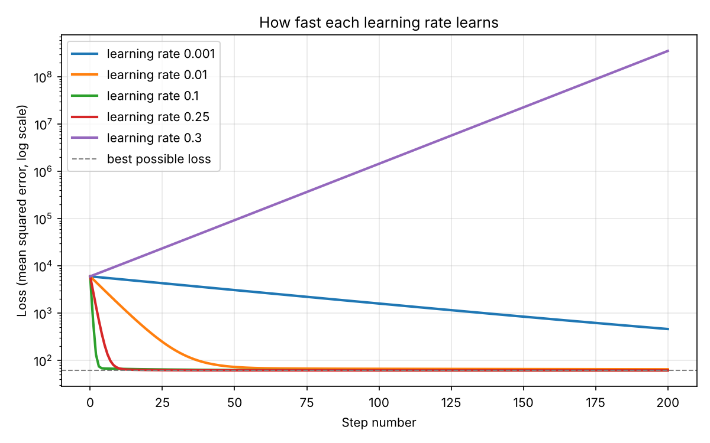
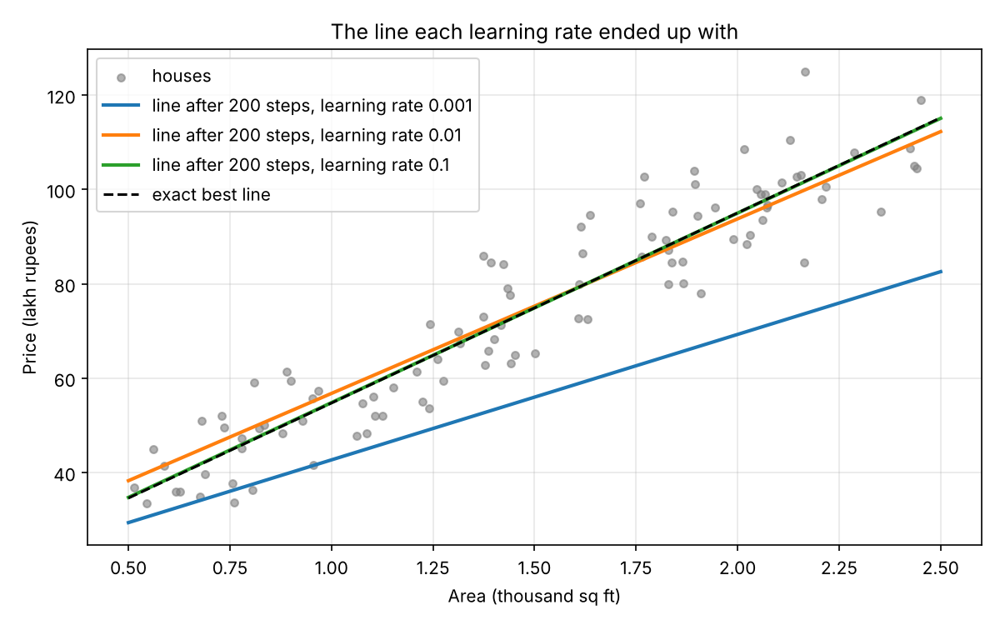
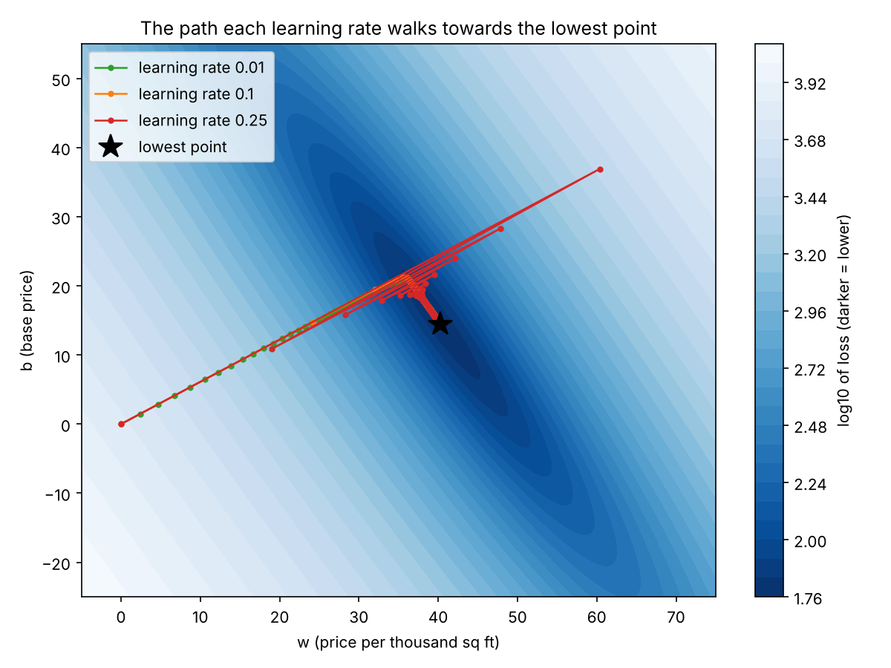

# Gradient Descent from Scratch

Gradient descent written by hand in NumPy, without any machine-learning library, used to fit a straight line that predicts house price from house area. The project runs the same algorithm with five learning rates to show how the step size decides whether learning is slow, fast, or breaks down completely.

## The problem

The script generates 100 houses with a fixed random seed:

- **area** between 500 and 2,500 sq ft (stored as 0.5 to 2.5, in thousand sq ft)
- **price** in lakh rupees, following `price = 40 × area + 15` plus random noise

Gradient descent has to find the line `price = w × area + b` that fits these houses best, starting from a bad guess of `w = 0, b = 0`.

## How it works

The algorithm has three parts, each a short function in the code:

**1. Loss: how wrong is the line?**

The mean squared error, the average of (predicted price − real price)² over all houses. Lower is better.

**2. Gradient: which way is uphill?**

The slope of the loss with respect to `w` and to `b`:

```
dw = 2 × mean(error × area)
db = 2 × mean(error)
```

**3. Update: take a step downhill**

```
w = w − learning_rate × dw
b = b − learning_rate × db
```

This repeats for 200 steps. The **learning rate** is the step size, and it is the only thing that changes between the five runs.

The answer is checked against the exact best line from the least-squares formula (`numpy.polyfit`), which gives `price = 40.31 × area + 14.44`, with a loss of 61.37.

## Results

| Learning rate | w | b | Loss after 200 steps | Outcome |
|---|---|---|---|---|
| 0.001 | 26.59 | 16.10 | 460.95 | Too slow, still far from the answer |
| 0.01 | 36.99 | 19.79 | 64.84 | Close, but not there yet |
| 0.1 | 40.17 | 14.66 | 61.37 | Reaches the best loss |
| 0.25 | 40.31 | 14.44 | 61.37 | Matches the exact answer |
| 0.3 | −8,638.86 | −5,359.27 | 352,187,912.84 | Diverges: each step overshoots further |

**Why 0.25 works but 0.3 explodes.** For this data and loss, gradient descent is only stable when the learning rate is below about 0.296. That limit comes from how steeply the loss curves in its steepest direction. At 0.25 each step overshoots the lowest point but lands closer to it every time; at 0.3 each overshoot is bigger than the last, so the values grow without limit.

**How many steps each rate needs.** Running longer than 200 steps, the rates reach the exact answer to within 0.05 after:

| Learning rate | Steps needed |
|---|---|
| 0.01 | under 5,000 |
| 0.1 | under 1,000 |
| 0.25 | under 200 |

So within the stable range, a bigger step size reaches the answer much faster.

## Plots

Running the script saves three images next to it.

**Loss at every step**



On a log scale, 0.1 and 0.25 drop to the best possible loss within about 10 steps, 0.01 takes about 75 steps to get close, and 0.001 is still falling slowly after 200. The loss for 0.3 climbs in a straight line on the log scale, which means it grows exponentially.

**The fitted lines**



The lines each learning rate ended with after 200 steps, against the houses and the exact best line.

**The path across the loss landscape**



Each point on this map is a possible `(w, b)`, coloured by its loss, with the lowest point marked by a star. The loss forms a long, narrow valley. Every run first moves quickly towards the valley and then travels slowly along it. The run at 0.25 visibly zig-zags across the valley as it overshoots, while still closing in on the lowest point.

## How to run

You need Python 3 with NumPy and Matplotlib.

```bash
pip install numpy matplotlib
python gradient_descent.py
```

The script prints the results table, saves the three images in the current folder, and opens the plots in a window.

## Code structure

Everything is in `gradient_descent.py`:

| Part | Purpose |
|---|---|
| Data generation | 100 houses from `price = 40 × area + 15` plus noise, with seed 42 so results repeat exactly |
| `loss(w, b)` | Mean squared error of a line |
| `gradient(w, b)` | Slope of the loss with respect to `w` and `b` |
| `gradient_descent(learning_rate, steps)` | Runs the updates from `w = 0, b = 0` and records `w`, `b`, and the loss at every step |
| Results table | Compares each run with the exact least-squares line |
| Plots | Saves the loss curves, fitted lines, and loss-landscape path |

## Possible improvements

- Scale the area feature (for example to mean 0, standard deviation 1), which widens the stable learning-rate range and speeds up convergence
- Stop automatically when the loss stops improving instead of always running 200 steps
- Add stochastic and mini-batch gradient descent and compare them with the full-batch version
- Add momentum or Adam, which handle narrow valleys like this one better
- Extend to more than one input feature

## Author

Payal Satapathy
